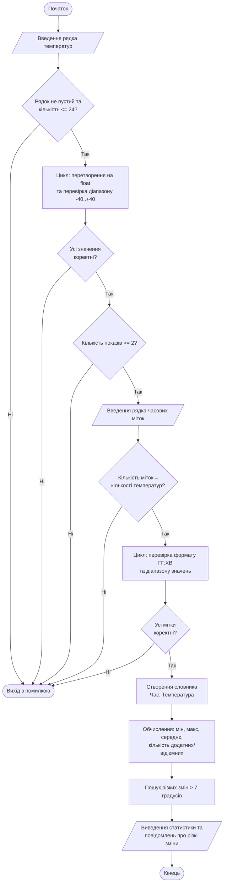

# Національний технічний університет "Харківський політехнічний інститут"

## Звіт про виконання лабораторної роботи №1
**з курсу "Прикладне програмування на Python"**

**Тема:** Засвоєння основ мови програмування на Python

**Виконав:** студент групи ІКМ-724в Д'яченко С. А.  
**Перевірив:** Дмитро Григорович Караман  

**Харків, 2026**

---

## Мета роботи
Створення програми, яка виконує приймання даних, введених користувачем, виконує їх обробку та виводить результат відповідно до індивідуального завдання. Під час виконання закріпити навички роботи з основними типами даних Python, словниками, умовними операторами та циклами.

## 1. Опис завдання
Написати програму для аналізу температурних показників за день.
Користувач вводить до 24 значень температури одним рядком через пробіл. Температура повинна знаходитись у діапазоні від -40 до +40 °C. Після цього користувач вводить часові мітки для кожного вимірювання у форматі `година:хвилина`.

На основі введених даних програма повинна:
- перевірити правильність введених температур та часу;
- обчислити середню температуру;
- знайти максимальну та мінімальну температуру;
- визначити кількість додатних і від’ємних температур;
- виявити періоди різких змін температури (понад 7 градусів).

## 2. Алгоритм роботи програми

## 3. Код програми
import sys

print("=== Аналіз температурних показів за день ===")
print("Введіть до 24 значень температур (через пробіл):")

temp_input = input("Температури: ").strip()
temp_str_list = temp_input.split()

if not temp_input:
    print("Помилка: ви не ввели жодного значення.")
    sys.exit()

if len(temp_str_list) > 24:
    print("Помилка: введено більше 24 вимірювань.")
    sys.exit()

temperatures = []
for t_str in temp_str_list:
    try:
        t = float(t_str)
        if -40 <= t <= 40:
            temperatures.append(t)
        else:
            print(f"Помилка: значення {t} виходить за межі допустимого діапазону (-40..+40).")
            sys.exit()
    except ValueError:
        print(f"Помилка: значення '{t_str}' не є числом.")
        sys.exit()

if len(temperatures) < 2:
    print("Помилка: для аналізу потрібно ввести щонайменше два показники.")
    sys.exit()

print("\nВведіть часові мітки для кожного показу (у форматі 'година:хвилина') через пробіл:")
time_input = input("Мітки часу: ").strip()
time_str_list = time_input.split()

if len(time_str_list) != len(temperatures):
    print("Помилка: кількість часових міток не збігається з кількістю введених температур.")
    sys.exit()

valid_times = []
for time_str in time_str_list:
    parts = time_str.split(':')
    if len(parts) == 2 and parts[0].isdigit() and parts[1].isdigit():
        h, m = int(parts[0]), int(parts[1])
        if 0 <= h <= 23 and 0 <= m <= 59:
            valid_times.append(time_str)
        else:
            print(f"Помилка: неприпустимі значення годин або хвилин у '{time_str}'.")
            sys.exit()
    else:
        print(f"Помилка: невірний формат часу '{time_str}'. Очікується 'година:хвилина'.")
        sys.exit()

temp_data = {}
for i in range(len(valid_times)):
    temp_data[valid_times[i]] = temperatures[i]

times = list(temp_data.keys())
temps = list(temp_data.values())

total_measurements = len(temps)
avg_temp = sum(temps) / total_measurements
min_temp = min(temps)
max_temp = max(temps)
pos_count = sum(1 for t in temps if t > 0)
neg_count = sum(1 for t in temps if t < 0)

sudden_changes = []
for i in range(len(temps) - 1):
    diff = abs(temps[i+1] - temps[i])
    if diff > 7:
        sudden_changes.append((times[i], times[i+1], diff))

print("\n=== РЕЗУЛЬТАТ АНАЛІЗУ ===")
print("Температурні дані (час → температура):")
for time_mark, temp_val in temp_data.items():
    print(f"   {time_mark} → {temp_val:>6.1f} °C")

print(f"\nЗагальна кількість вимірювань: {total_measurements}")
print(f"Середня температура: {avg_temp:.2f} °C")
print(f"Максимальна температура: {max_temp:.1f} °C")
print(f"Мінімальна температура: {min_temp:.1f} °C")
print(f"Кількість додатних температур: {pos_count}")
print(f"Кількість від’ємних температур: {neg_count}")

if sudden_changes:
    print("\n[!] Виявлено різкі зміни температури (> 7°):")
    for change in sudden_changes:
        print(f"  між {change[0]} та {change[1]}: зміна на {change[2]:.1f}°C")

print("\n=== Кінець аналізу ===")
